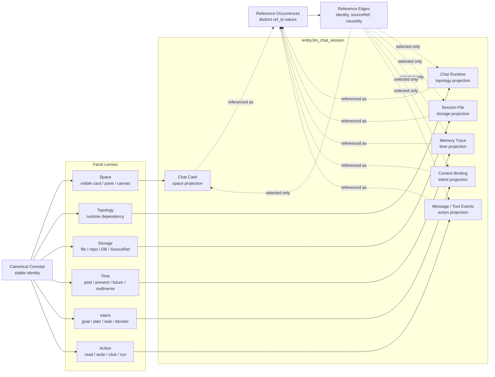

# Faceted Concept Model (Authoring / Deferred Explorer)

This is an ontology-authoring overview, not the current Ontology Card layout.
Composite-lens v2 does not mount an identity rail. It draws selected `ref_id`
occurrences from snapshot documents and preserves shared identity through
`concept_id`.



## Reading Rule

The diagram should be read as:

```text
one identity
  many facet projections
  many contextual occurrences
  selected-reference edges
```

It should not be read as one global containment tree, nor as a requirement to
show all facets at once. The v2 viewer chooses one occurrence and expands only
its direct children.
